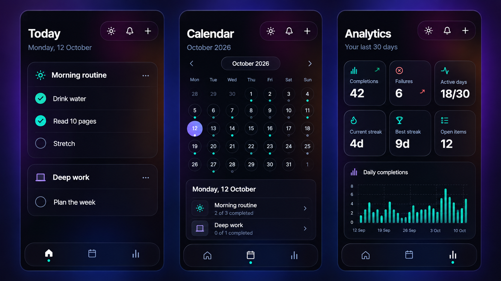

# Executor

Executor is a private, self-hostable daily planner for the work you need to do repeatedly and the work you only need to do once. It brings habits, measurable goals, tasks, reminders, a calendar, and honest progress tracking into one focused app.

You run your own copy and keep control of its database and credentials. Use it only on your computer, make it privately available to your devices with Tailscale, or deploy it as an always-on web app with Cloudflare.



*Privacy-safe product preview with fictional demo data. No production data or credentials are shown.*

## What you can do

### Plan the day without losing the bigger picture

Group work into plans, then add:

- **Tasks** for one-time work, with dates, priority, status, notes, and optional reminders.
- **Habits** for repeating actions such as reading, exercise, or a morning routine.
- **Metrics** for goals that are better measured than checked off, such as water, distance, or study time.
- **Waiting items** for work that is blocked by someone or something else.

Items can repeat every day, on weekdays, weekly, or on selected weekdays. A repeating item can also have a start and end date.

### Work from one clear Today screen

Today groups scheduled work by plan and shows progress as you complete it. You can move through previous and future dates, finish an item late without rewriting its history, send a task to tomorrow, mark it as waiting, or move one occurrence of a repeating item without changing the whole series.

Missed recurring items remain visible so they do not silently disappear. One-time overdue tasks are kept separate from today’s scheduled work.

### Capture first, schedule later

Tasks without a date land in the Inbox instead of crowding Today. From there you can schedule them for today or tomorrow, edit them, or mark them as waiting.

### See the month and act from the calendar

The Calendar shows scheduled and completed work by day. Select a date to inspect its plans and items, update progress, or open that date in the Today view.

### Understand what is actually getting done

Analytics covers the latest 30 days:

- **Completions** count finished task, habit, and metric occurrences.
- **Failures** count scheduled items left incomplete on finished days. Today is not called a failure while the day is still in progress.
- **A streak day** requires every task, habit, and metric scheduled for that day to be complete. A day with nothing scheduled does not extend a streak.
- **Active days, best streak, open items, and a daily chart** give extra context instead of reducing progress to a single number.

### Use it like an app

Executor is an installable Progressive Web App with light and dark themes, an offline shell, and web push notifications. It can send morning and evening check-ins plus reminders attached to individual items. An optional Expo shell packages the same interface as a native Android/iOS app and supports native push notifications.

### Keep and recover your data

The repository includes PostgreSQL migrations, local backup and restore commands, health checks, and guarded deployment scripts. Executor is deliberately a single-administrator app: it is intended for one owner, not public registration or a shared team workspace.

## Choose how you want to run it

| Mode | Best for | Where you open it | What stays running | Scheduled notifications |
| --- | --- | --- | --- | --- |
| **Local only** | One computer, development, or trying the app | `http://localhost:3000` | Your computer, PostgreSQL, web app, and API | Not automatic unless you provide a scheduler |
| **Private with Tailscale** | Your own phone, tablet, and computers without exposing Executor publicly | A private `https://…ts.net` address | The host computer, PostgreSQL, web app, API, and Tailscale | Same limitation as local use unless the API has a scheduler |
| **Public self-hosted** | Always-on access and automatic reminders | Your own HTTPS domains | Cloudflare Workers and PostgreSQL | Yes, through the deployed API's cron triggers |

All three modes use the same app and single-owner login. “Public self-hosted” means the login page is reachable on the internet; your data still requires authentication. Tailscale Serve is private to your tailnet. **Tailscale Funnel is public and should not be used when private access is the goal.**

The full instructions, including exact environment variables and security checks, are in [the deployment guide](docs/deployment.md).

## Try it locally

You need Node.js 20.9 or newer and access to PostgreSQL. The included database adapter uses Neon’s serverless driver, so Neon is the simplest supported choice. Using another PostgreSQL provider may require replacing that adapter.

1. Install the project:

   ```bash
   npm install
   ```

2. Copy `apps/api/.dev.vars.example` to `apps/api/.dev.vars` and replace every placeholder. This ignored file holds your database URLs, owner email, authentication secrets, and push-notification keys.

3. If your API will not use the default `http://localhost:8787`, copy `apps/web/.env.example` to `apps/web/.env.local` and set its public API URL.

4. Create the database tables and start both apps:

   ```bash
   npm run db:migrate
   npm run dev
   ```

5. Follow the prompt-based [owner setup](docs/deployment.md#access-control-setup) once. `OWNER_EMAIL` must exactly match `ALLOWED_ADMIN_EMAIL`.

6. Open [http://localhost:3000](http://localhost:3000). The API health check is at [http://localhost:8787/health](http://localhost:8787/health).

Do not commit `apps/api/.dev.vars`, `.env.local`, database dumps, or any file containing a real credential. See [Security and privacy](#security-and-privacy) before publishing a fork.

## Deploy it

### Keep it on one computer

Run `npm run dev` whenever you want to use Executor and open the local URL. No router changes, DNS, Cloudflare account, or Tailscale account are required. This is the smallest setup, but the machine and both app processes must remain awake while you use it.

[Local setup details →](docs/deployment.md#localhost-only)

### Reach it privately with Tailscale

Install Tailscale on the host and your approved devices. Keep Executor bound to `127.0.0.1`, then use Tailscale Serve to give the web app and API separate private HTTPS endpoints. Update the ignored API and web environment files with those addresses and restart the app.

This is a good fit for a home server, mini PC, laptop, or other machine you control. It avoids router port forwarding and does not require making the app public. The host still needs to stay online.

[Tailscale setup, commands, and security notes →](docs/deployment.md#private-access-with-tailscale)

### Run it continuously on Cloudflare

For an always-available installation, create your own PostgreSQL database, Cloudflare Workers, HTTPS domains, and secrets. Copy the tracked example Wrangler files to their ignored `*.private.*` counterparts, add your own values, apply migrations, deploy the API, and then deploy the web app.

The production scripts refuse to deploy without private configuration. This prevents a fresh clone from accidentally targeting the original operator’s Workers or domains.

[Full Cloudflare deployment walkthrough →](docs/deployment.md#public-self-hosting)

### Install it on a phone

After the web app is reachable over HTTPS, install it from a supported browser as a PWA. If you want a store-style native build, configure the optional Expo app with your own Expo/Firebase projects, package identifiers, signing credentials, and deployed web/API URLs.

[PWA and Web Push →](docs/deployment.md#pwa-and-web-push) · [Native Expo app →](docs/deployment.md#native-expo-app)

## Security and privacy

Executor is safe to publish as source code only when each operator supplies their own private configuration.

- The browser never receives a database URL or server secret.
- Protected API routes require a valid session, the allowlisted owner email, and the `admin` role.
- Initial account creation also requires a separate high-entropy bootstrap token.
- Production secrets belong in Cloudflare Worker secrets; local secrets belong in ignored `.dev.vars` files.
- Database backups, production data, Firebase files, signing files, private Wrangler configs, and real `.env` files must never be committed.
- Public identifiers such as domains, Expo/Firebase project IDs, package names, and `NEXT_PUBLIC_*` values are not passwords, but fork owners should still replace them with their own.

Read [SECURITY.md](SECURITY.md) before publishing or deploying a fork. If a credential ever reaches Git history, revoke or rotate it first—deleting it in a later commit does not make the old value private.

## For contributors

Executor is an npm-workspaces monorepo:

- `apps/web` — Next.js 16 frontend and installable PWA.
- `apps/api` — Hono API and Cloudflare Workers entrypoint.
- `apps/mobile` — optional Expo native shell.
- `packages/domain` — recurrence, civil-date, quantity, and visibility rules.
- `packages/contracts` — shared request validation schemas.

Important commands:

| Command | Purpose |
| --- | --- |
| `npm run dev` | Run web and API locally |
| `npm run test` | Run all tests |
| `npm run typecheck` | Type-check all workspaces |
| `npm run lint` | Lint supported workspaces |
| `npm run build` | Build the web app and dry-run the API bundle |
| `npm run db:generate` | Generate committed Drizzle migrations |
| `npm run db:migrate` | Apply migrations using the ignored API environment file |
| `npm run db:backup` | Create a timestamped dump in the ignored `backups/` directory |
| `npm run db:restore:fallback` | Restore a dump to the configured fallback database after confirmation |
| `npm run api:deploy` | Deploy the API Worker |
| `npm run web:deploy` | Build and deploy the web Worker |
| `npm run deploy` | Deploy the API first, then the web app |

More detail: [architecture](docs/architecture.md) · [deployment](docs/deployment.md) · [security](SECURITY.md)
